<div align="center">

# 💬 FundMessenger · 펀드메신저

**대학 투자동아리를 위한 올인원 협업 플랫폼**

세미나 자료 · 종목 토론 · 모의 펀드 운용을 한 곳에서.<br/>
국내·해외 시세, 뉴스, AI 분석을 동아리 활동 흐름 안에 붙였습니다.


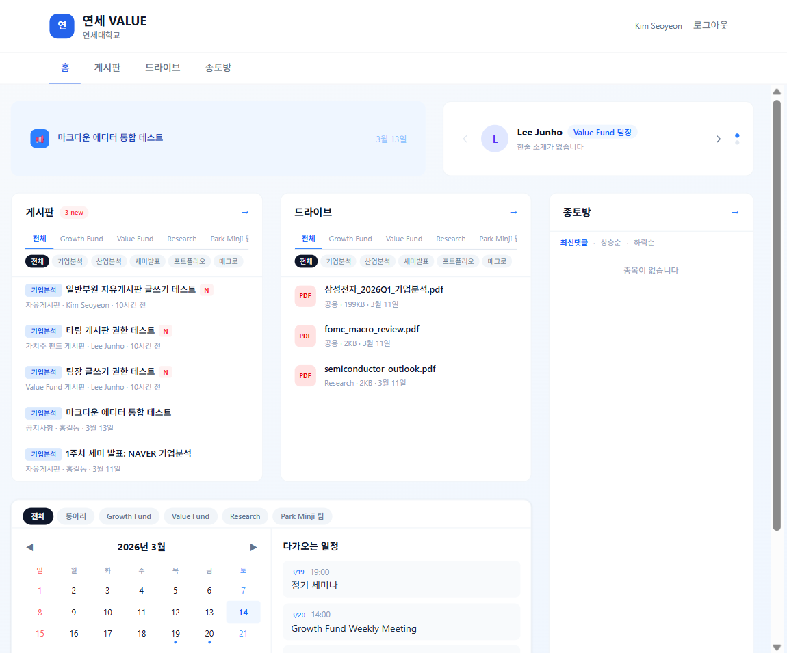

<sub>동아리 홈. 공지, 팀장 소개, 게시판·드라이브·종토방·캘린더를 한 화면에 모았습니다. 화면 속 이름과 동아리는 개발용 시드 데이터입니다.</sub>

</div>

<br/>

## 목차

1. [한눈에 보기](#-한눈에-보기)
2. [화면](#-화면)
3. [주요 기능](#-주요-기능)
4. [시스템 구조](#-시스템-구조)
5. [핵심 흐름](#-핵심-흐름)
6. [기술 스택과 고른 이유](#-기술-스택과-고른-이유)
7. [도메인 모델](#-도메인-모델)
8. [기술적으로 공들인 부분](#-기술적으로-공들인-부분)
9. [폴더 구조](#-폴더-구조)
10. [로컬에서 실행하기](#-로컬에서-실행하기)
11. [테스트](#-테스트)
12. [개발 과정](#-개발-과정)
13. [한계와 다음 단계](#-한계와-다음-단계)
14. [이 저장소에 대해](#-이-저장소에-대해)

<br/>

## 🔭 한눈에 보기

| | |
|---|---|
| **풀려는 문제** | 투자동아리 활동(세미나 PDF, 종목 토론, 펀드팀 매매 결정)이 단톡방과 개인 드라이브에 흩어져 기록이 남지 않습니다. |
| **해결** | 게시판 · PDF 드라이브 · 채팅 · 펀드팀 매매 기록을 **동아리 단위로 묶고**, 시세 · 뉴스 · AI 분석을 그 안에 붙였습니다. |
| **사용자** | 동아리 회원(회장단 · 팀장 · 부원 · 졸업생)과, 여러 동아리를 관리하는 운영자(슈퍼어드민). 동아리가 구독하고 회원이 쓰는 구조입니다. |
| **외부 연동** | 한국투자증권(KIS) OpenAPI 시세 · 랭킹, 뉴스 검색 API 4종(Naver · SerpAPI · Tavily · MarketAux), LLM 2종(Gemini · Cerebras), 소셜 로그인 3종 |
| **운영** | 2026-03-20 Google Cloud Run + Cloudflare Pages로 실제 배포해 동아리에서 썼습니다. 동시 접속 40명, 70명에 맞춰 요청 제한을 두 번 조정했습니다. 지금은 운영하지 않습니다. |

**규모** (센 방법은 [맨 아래](#숫자를-센-방법)에 적었습니다)

| REST 컨트롤러 | HTTP 엔드포인트 | 테이블 | 백엔드 코드 | 프론트 코드 | 테스트 |
|:---:|:---:|:---:|:---:|:---:|:---:|
| **37** | **273** | **60** | Java 389개 파일<br/>약 3.5만 줄 | JS/JSX 133개 파일<br/>약 3.5만 줄 | 49개 파일<br/>`@Test` 274개 |

<br/>

## 🖼 화면

<table>
  <tr>
    <td width="50%" valign="top">
      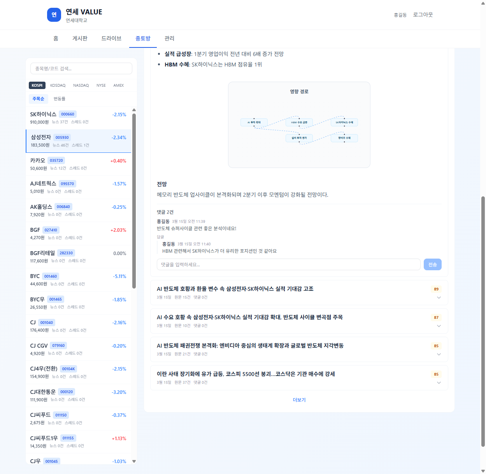
      <p align="center"><b>종토방 · AI 뉴스 브리핑</b><br/><sub>모은 뉴스를 이슈별 카드로 정리하고, 영향 경로를 다이어그램으로 보여 줍니다</sub></p>
    </td>
    <td width="50%" valign="top">
      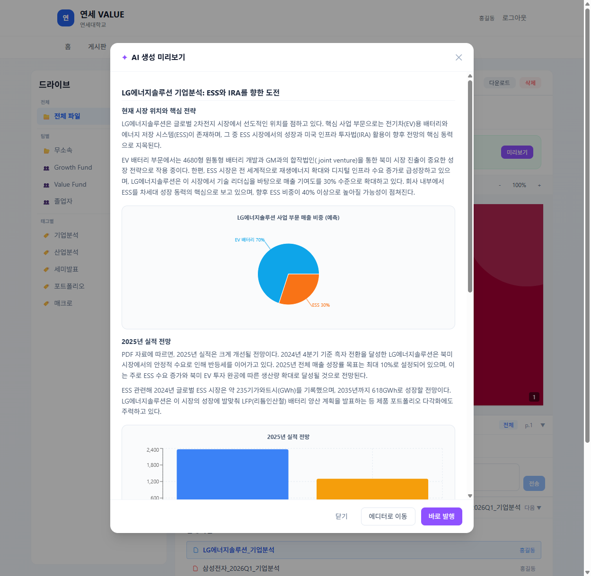
      <p align="center"><b>PDF → AI 분석 글</b><br/><sub>드라이브의 기업분석 PDF로 차트가 들어간 글 초안을 만들고 바로 발행합니다</sub></p>
    </td>
  </tr>
  <tr>
    <td width="50%" valign="top">
      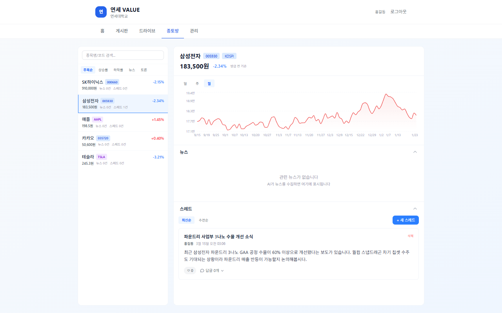
      <p align="center"><b>종토방 · 종목 상세</b><br/><sub>KIS 시세로 그린 일·주·월 차트와 종목별 토론 스레드</sub></p>
    </td>
    <td width="50%" valign="top">
      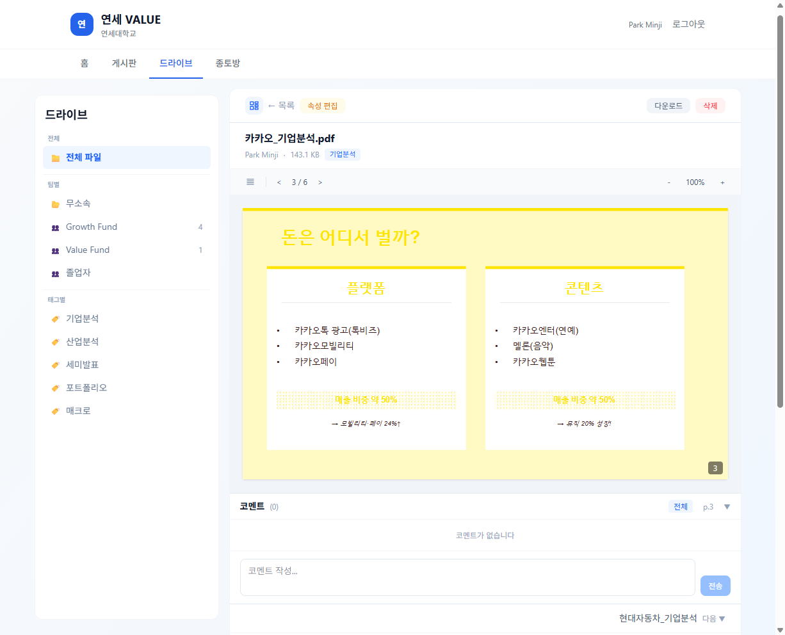
      <p align="center"><b>드라이브 · PDF 뷰어</b><br/><sub>세미나 자료를 팀·태그로 분류하고 페이지마다 코멘트를 남깁니다</sub></p>
    </td>
  </tr>
  <tr>
    <td width="50%" valign="top">
      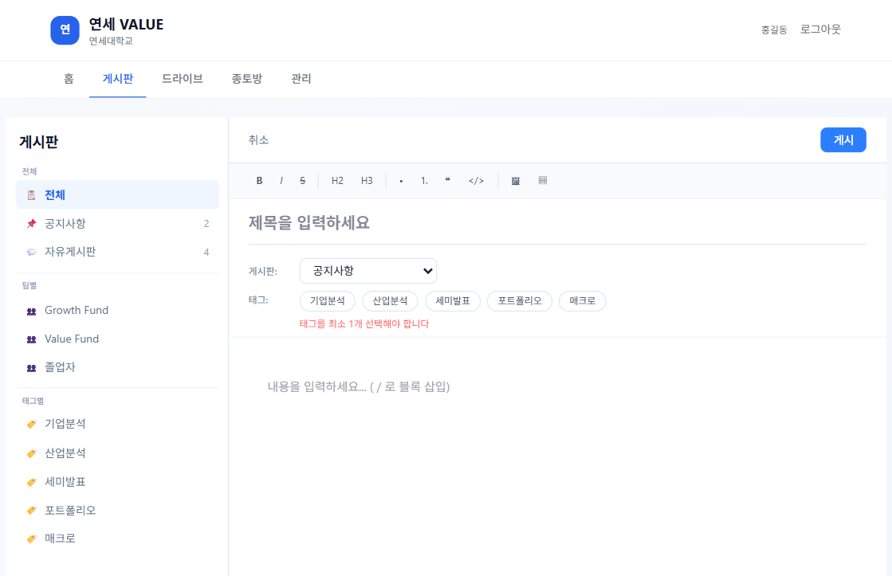
      <p align="center"><b>게시판 · 글쓰기</b><br/><sub>TipTap 에디터(마크다운 저장), 게시판·태그 선택</sub></p>
    </td>
    <td width="50%" valign="top">
      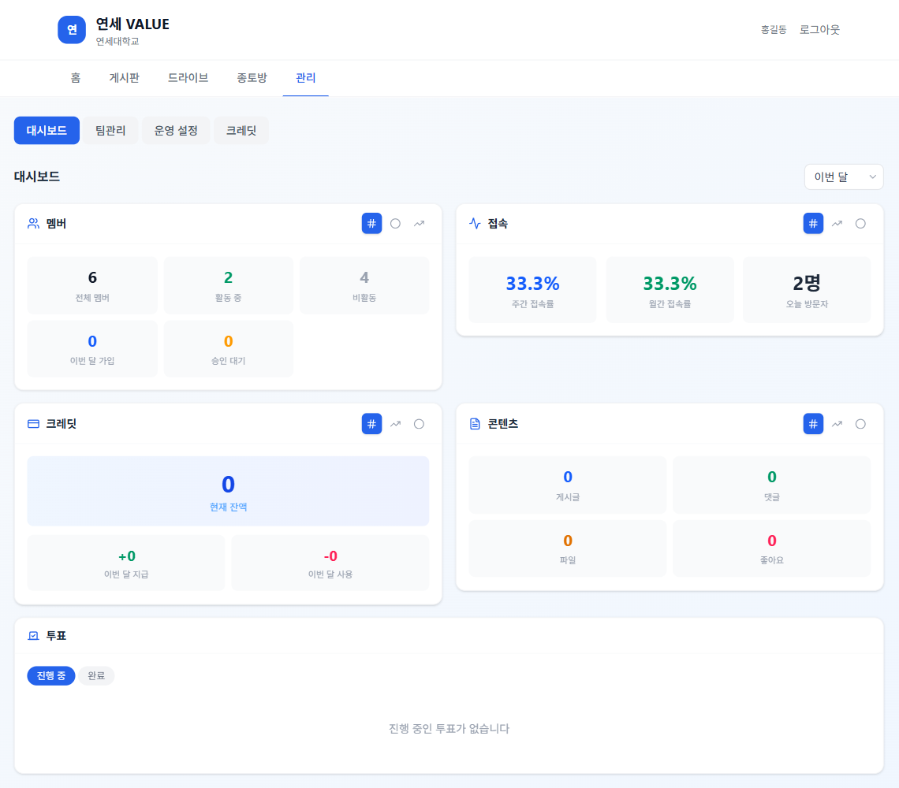
      <p align="center"><b>관리 · 대시보드</b><br/><sub>멤버·접속률·크레딧·콘텐츠·투표를 한눈에</sub></p>
    </td>
  </tr>
</table>

<p align="center">
  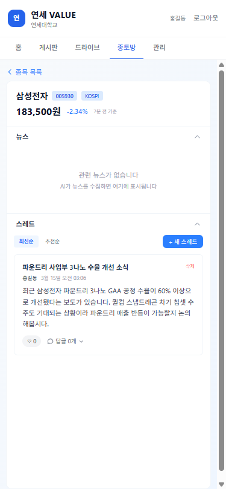<br/>
  <sub><b>모바일(375px)</b> · 홈 화면에 앱처럼 설치하는 PWA이고, 브라우저 푸시 알림을 받습니다</sub>
</p>

<br/>

## ✨ 주요 기능

<details open>
<summary><b>👥 가입과 권한</b></summary>

- Google 소셜 로그인 → 학교·동아리 선택 → 가입 신청 → 운영진 승인.
- 회원 상태는 `NO_CLUB → PENDING → APPROVED / REJECTED`, 이후 `ALUMNI`(졸업) · `INACTIVE`(탈퇴)로 바뀝니다.
- 권한은 **멤버 태그 하나**(회장 · 부회장 · 팀장 · 팀원 등)로 정합니다. 역할 테이블을 여러 개 두지 않고 태그로 통합했습니다.
- 카카오 · 네이버 로그인도 구현했지만 플랫폼 심사 전이라 버튼을 꺼 두었습니다.
</details>

<details open>
<summary><b>🏛 동아리 운영 (관리 탭)</b></summary>

- 대시보드(멤버 · 접속률 · 크레딧 · 콘텐츠 · 투표), 드래그 앤 드롭 팀 관리, 운영 설정, 공지, 구독 만료 자동 처리.
- **크레딧**: 동아리가 팀에 나눠 주는 내부 포인트(1크레딧 = 100원 기준). AI 기능을 쓸 때 차감됩니다.
- **기수 전환**: 새 기수로 넘어갈 때 지난 기수 활동을 아카이브합니다.
</details>

<details open>
<summary><b>📝 콘텐츠</b></summary>

- **게시판**: TipTap 에디터(마크다운으로 저장), 게시판 · 태그 분류, 댓글 · 대댓글, 좋아요.
- **드라이브**: PDF 업로드 · 뷰어, 페이지별 코멘트, 팀 · 태그별 분류.
</details>

<details open>
<summary><b>🤖 AI</b></summary>

- **PDF → 분석 글**: 드라이브의 PDF(기업분석 자료 등)로 차트가 들어간 분석 글 초안을 만들고, 미리 본 뒤 바로 발행하거나 에디터로 옮깁니다.
- **AI 댓글봇**: 페르소나를 가진 봇이 게시글 · 뉴스 · 스레드에 댓글을 달아 토론을 이어 갑니다.
- **AI 의사결정서 · 운용보고서**: 펀드팀의 매매 기록으로 보고서를 만듭니다.
</details>

<details open>
<summary><b>📈 종토방 (종목 토론방)</b></summary>

- KOSPI · KOSDAQ · NASDAQ · NYSE · AMEX 종목 목록, 등락률 · 시가총액 · 거래량 랭킹, 일 · 주 · 월 차트.
- 뉴스를 모아 AI가 **이슈별 브리핑 카드**(영향 경로 다이어그램 포함)로 정리하고, 종목에 연결합니다.
- 종목별 스레드와 댓글로 토론합니다.
</details>

<details open>
<summary><b>💼 펀드팀 (모의 펀드 운용)</b></summary>

- 팀원이 매수 · 매도 요청 → 팀장이 토론에 부치거나 승인 · 거절 → 승인되면 포지션에 반영.
- 매매 계획, 조기 청산 · 토론 요청, 변경 감사 로그, 팀 통계와 멤버 랭킹.
</details>

<details open>
<summary><b>🔔 소통과 알림</b></summary>

- 동아리 · 팀 실시간 채팅(WebSocket), 채팅 안 투표, 이모지 · 스티커, 캘린더.
- 인앱 알림과 브라우저 Web Push.
</details>

<br/>

## 🏗 시스템 구조

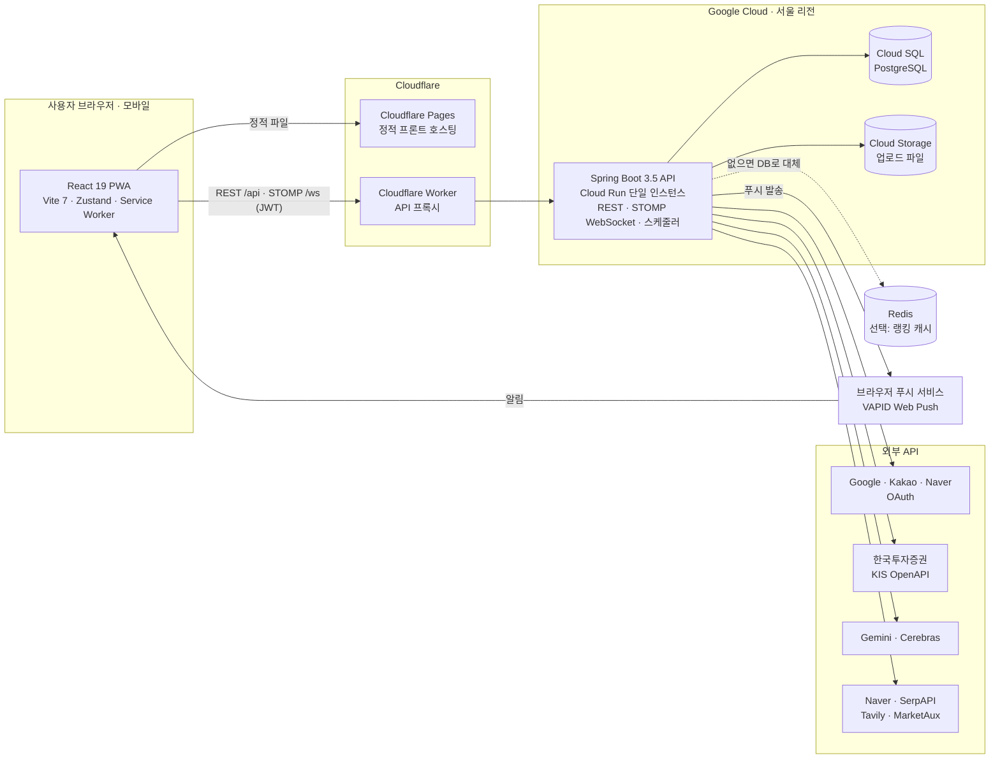

- **로컬**에서는 Cloudflare · GCP 없이 `localhost:3000`(Vite) → `localhost:8080`(Spring) → `localhost:5434`(Docker PostgreSQL)로 바로 연결됩니다.
- 파일 저장은 **이중 모드**입니다. `GCS_BUCKET_NAME`이 있으면 Cloud Storage, 비어 있으면 로컬 `uploads/`에 저장합니다.
- 서울 리전 Cloud Run은 커스텀 도메인 연결을 지원하지 않아, Cloudflare Worker로 API 도메인을 프록시했습니다. 자세한 내용은 [배포 가이드](docs/deployment.md)에 있습니다.

<br/>

## 🔁 핵심 흐름

### PDF → AI 분석 글 (비동기 2단계 파이프라인)

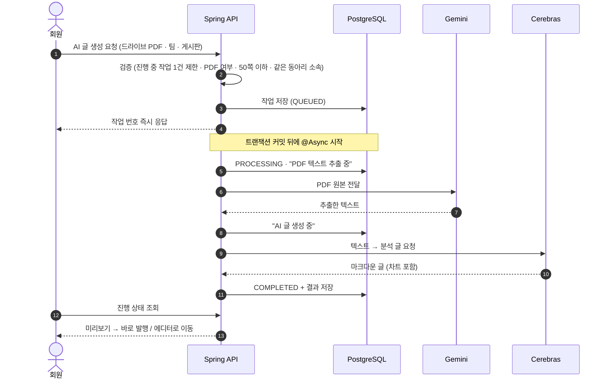

- 요청 트랜잭션이 커밋된 뒤에만 비동기 작업을 시작해서, 저장되지 않은 작업을 백그라운드가 먼저 읽는 일을 막았습니다.
- 진행 단계를 작업 테이블에 남겨 화면에 그대로 보여 줍니다. 실패하면 `FAILED`와 오류 메시지를 남깁니다.

### 펀드팀 매매 요청

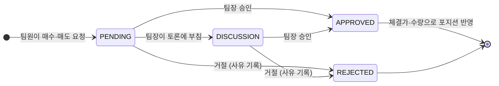

- 승인할 때 체결가와 수량을 따로 넣을 수 있고, 비우면 요청 값을 씁니다. 매수는 포지션을 열거나 늘리고, 매도는 줄이거나 닫습니다.
- 포지션 변경과 크레딧 분배에는 비관적 락을 걸어, 동시에 승인해도 숫자가 어긋나지 않게 했습니다.

<br/>

## 🧰 기술 스택과 고른 이유

| 영역 | 기술 | 고른 이유 |
|---|---|---|
| **백엔드** | Spring Boot 3.5.0, Java 21, Spring Security, Spring Data JPA | 목표가 "팀 하나(5\~10명)"에서 "여러 대학 동아리(1,500\~2,000명)"로 커지며 1세대 FastAPI에서 옮겼습니다. 두 백엔드를 함께 두는 안은 기능 중복과 유지보수 비용 때문에 버리고 Spring으로 통합했습니다. |
| **인증** | OAuth2 직접 구현(WebClient) + JJWT 0.12.6 | SPA + JWT 구조에 맞추려고 Spring OAuth2 Client 대신 REST 호출로 구현했습니다. 이메일 가입은 메일 발송 부담 때문에 빼고 소셜 로그인만 남겼습니다. |
| **DB** | PostgreSQL 16 (운영: Cloud SQL) | 1세대부터 써 온 DB입니다. |
| **캐시** | Redis (선택) | 종목 랭킹 스냅샷 캐시입니다. 연결이 안 되면 DB 스냅샷으로 대체합니다. |
| **실시간** | WebSocket + STOMP (`@stomp/stompjs`) | "실시간은 전부 WebSocket, 폴링 없음"을 원칙으로 정했습니다. |
| **푸시** | web-push 5.1.1(VAPID) + BouncyCastle, vite-plugin-pwa | 네이티브 앱 없이 모바일 알림을 보냅니다. |
| **에디터** | TipTap 3 + tiptap-markdown | ProseMirror 기반이고 마크다운으로 저장할 수 있어 BlockNote 대신 골랐습니다. |
| **AI** | Gemini 2.5 Flash 계열, Cerebras (Qwen3 235B) | GPT-5 mini에서 바꿨습니다. 무료 등급과 이미지 이해 성능 덕분에 글 1건 비용이 약 $0.007에서 $0이 됐습니다. |
| **PDF** | Apache PDFBox 3.0.4 | 페이지 수 확인과 이미지 변환에 씁니다. |
| **보안** | jsoup 1.18 Safelist, bucket4j 8.10 | 게시글 HTML 정화와 요청 수 제한에 씁니다. |
| **프론트** | React 19.2, Vite 7.3, Tailwind CSS 4.2, Zustand 5, React Router 7 | |
| **시각화** | lightweight-charts 4, recharts 3, @xyflow/react 12 | 캔들 차트, 대시보드·글 속 차트, 뉴스 영향 경로 다이어그램에 각각 씁니다. |
| **배포** | Docker 멀티스테이지 → Cloud Run, Cloudflare Pages · Worker | 서울 리전의 도메인 제약을 Worker로 우회했습니다. |

<br/>

## 🗂 도메인 모델

핵심 테이블 12개만 그렸습니다(전체 60개). 다대다 관계는 조인 테이블(`post_boards`, `drive_file_teams`)로 연결합니다.

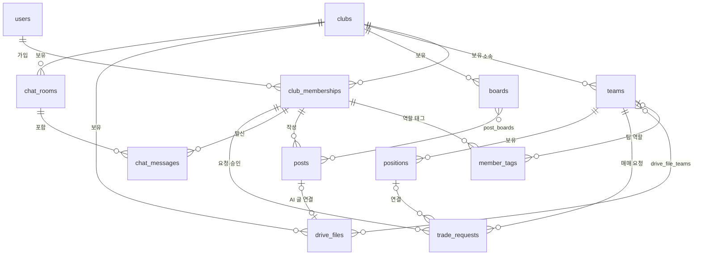

- **사람(`users`)과 동아리 회원 자격(`club_memberships`)을 나눴습니다.** 그래서 한 사람이 동아리마다 다른 역할과 상태를 가질 수 있습니다. 글 · 파일 · 채팅 · 매매 요청의 작성자는 모두 `club_memberships`를 가리킵니다.
- 그 밖의 테이블: 뉴스(`raw_news`, `canonical_news`, `news_clusters`, `stock_news_couplings`), 종목(`stocks`, `stock_threads`, `stock_ranking_snapshots`), 크레딧(`credit_history`), 알림(`notifications`, `push_subscriptions`), AI 작업(`ai_generation_jobs`) 등.

<br/>

## 🛠 기술적으로 공들인 부분

| 문제 | 해결 | 코드 |
|---|---|---|
| 프록시를 거치면 OAuth 쿠키가 전달되지 않음 | OAuth `state`를 서버 메모리에 저장해 쿠키 없이 검증 | `auth/` |
| 카카오톡 같은 인앱 브라우저에서 Google 로그인이 막힘 | 인앱 브라우저를 감지해 외부 브라우저로 넘김 | `frontend/src/pages/LoginPage.jsx` |
| 채팅 메시지가 저장되기 전에 화면에 먼저 퍼짐 | 저장 트랜잭션이 커밋된 뒤에만 브로드캐스트(`@TransactionalEventListener(AFTER_COMMIT)`), WebSocket 연결 단계에서 JWT 검증 | `config/WebSocketConfig.java`, `chat/` |
| 무료 LLM 키의 분당 한도에 자주 걸림 | 키마다 워커 스레드 하나를 두는 큐 구조. 사용자 요청을 먼저 처리하는 우선순위 큐, 키별 분당 요청·토큰 한도 추적, 429가 오면 그 키만 쉬게 하고 최대 10회 재시도 | `config/CerebrasClient.java` |
| 뉴스가 많고 같은 이슈가 반복됨 | 스케줄러(기본 1시간)로 모아 클러스터링 → 분석 → 브리핑·종목 연결 → 검증의 4단계로 처리. 같은 이슈는 6시간 뒤에야 다시 갱신. 검색은 국내 Naver → SerpAPI, 해외 Tavily → MarketAux 순으로 넘어가고 키별 하루 한도를 추적 | `jongtobang/service/NewsPipelineService.java`, `config/newssearch/` |
| 시세 API 호출이 많음 | KIS 토큰 관리, 관심 종목 10분 주기 갱신. 랭킹은 Redis를 먼저 보고 없으면 DB 스냅샷 사용 | `jongtobang/service/StockPriceService.java` |
| 실제 운영에서 접속자가 늘며 요청이 막힘 | bucket4j로 사용자·IP별 버킷(인증 60회/분, 업로드 30회/분, 그 밖 600회/분, 버킷 최대 1만 개). 동시 접속 40명, 70명일 때 두 번 조정 | `config/RateLimitFilter.java` |
| 동시에 크레딧을 나누거나 매매를 승인하면 숫자가 어긋날 수 있음 | 비관적 락(`PESSIMISTIC_WRITE`) + 10스레드 동시성 테스트로 확인 | `test/.../concurrency/` |
| 다른 동아리의 자원을 ID만 바꿔 열어 볼 수 있는 위험(IDOR) | 서비스마다 동아리 소속을 검사하고 접근 차단 테스트로 확인 | `test/.../security/IdorSecurityTest` |
| 게시글 HTML에 스크립트가 섞일 위험 | jsoup Safelist로 정화 | `config/InputSanitizer.java` |

<sub>경로는 `backend/src/main/java/com/fundmessenger/` 기준입니다.</sub>

<br/>

## 📁 폴더 구조

```text
.
├── backend/                     Spring Boot API (Gradle wrapper 포함)
│   ├── build.gradle             bootRun·test 때 루트 .env 를 읽어 환경변수로 넣음
│   └── src/
│       ├── main/java/com/fundmessenger/     (괄호 안은 파일 수)
│       │   ├── club/            동아리·팀·멤버 태그·가입 승인·크레딧·공지 (76)
│       │   ├── fund/            펀드팀 포지션·매매 요청·의사결정서·통계 (70)
│       │   ├── jongtobang/      종토방·KIS 시세·뉴스 파이프라인 (49)
│       │   ├── board/           게시판·글·댓글·기수 아카이브 (31)
│       │   ├── chat/            STOMP 채팅·투표 (29)
│       │   ├── config/          Security·WebSocket·요청 제한·LLM·뉴스 검색 클라이언트 (25)
│       │   ├── ai/              PDF → AI 분석 글, AI 댓글봇 (19)
│       │   ├── notification/    알림·Web Push (16)
│       │   ├── drive/           PDF 드라이브·코멘트 (15)
│       │   ├── auth/            OAuth2·JWT·dev-login (8)
│       │   └── admin/ calendar/ file/ home/ sticker/ support/ user/
│       ├── main/resources/application.yml
│       └── test/                JUnit 5 테스트 49개 파일
├── frontend/                    React 19 + Vite 7 PWA
│   └── src/
│       ├── pages/               화면 20개
│       ├── components/  store/  hooks/  layouts/  lib/
│       └── sw.js                서비스 워커 (푸시 수신)
├── docs/
│   ├── deployment.md            운영 배포 가이드 (Cloud Run + Cloudflare)
│   └── feature-overview-legacy.md   1세대 기능 개괄서
├── assets/screenshots/          README 화면 캡처
├── Dockerfile                   백엔드 멀티스테이지 빌드 (Cloud Run용)
├── docker-compose.yml           로컬 PostgreSQL 16
└── .env.example                 환경변수 예시
```

<br/>

## 🚀 로컬에서 실행하기

**준비물**: JDK 21, Docker, Node.js 20.19 이상, Git

**1. 환경변수 파일 만들기**

```bash
cp .env.example .env
```

`backend/build.gradle`의 `bootRun` · `test` 태스크와 `docker compose`가 모두 루트의 `.env`를 읽습니다. `.env`는 `.gitignore`에 들어 있습니다. 이 파서는 `=` 뒤 전부를 값으로 읽으니, 주석은 줄을 따로 쓰세요.

| 구분 | 변수 | 설명 |
|---|---|---|
| 필수 | `DATABASE_URL` | `jdbc:postgresql://localhost:5434/fundmessenger` (코드 기본값은 5432라 꼭 지정) |
| 필수 | `DB_USERNAME`, `DB_PASSWORD` | docker-compose 값과 같게 |
| 필수 | `SECRET_KEY` | JWT 서명 키. 32바이트 이상 임의 문자열 |
| 필수 | `ENVIRONMENT` | 로컬은 `development`(dev-login · 시드 데이터 켜짐, 요청 제한 꺼짐), 운영은 `production` |
| 필수* | `GOOGLE_CLIENT_ID` · `_SECRET`, `KAKAO_CLIENT_ID` · `_SECRET`, `NAVER_OAUTH_CLIENT_ID` · `_SECRET` | 코드에 기본값이 없어서 변수 자체는 있어야 앱이 뜹니다 |
| 선택 | `VAPID_PUBLIC_KEY`, `VAPID_PRIVATE_KEY`, `VAPID_CLAIMS_EMAIL` | 웹 푸시 |
| 선택 | `GEMINI_API_KEYS`, `CEREBRAS_API_KEYS` (+ `_MODEL`) | AI 분석 글 · 뉴스 브리핑 · 댓글봇. 키 여러 개는 쉼표로 구분 |
| 선택 | `KIS_APP_KEY`, `KIS_APP_SECRET` | 한국투자증권 시세 |
| 선택 | `NAVER_CLIENT_ID` · `_SECRET`, `TAVILY_API_KEYS`, `SERPAPI_API_KEYS`, `MARKETAUX_API_KEY` | 뉴스 검색 |
| 선택 | `NEWS_PIPELINE_ENABLED` | 뉴스 파이프라인 스케줄 (예시 파일은 `false`) |
| 선택 | `REDIS_HOST`, `REDIS_PORT`, `REDIS_PASSWORD` | 랭킹 캐시. 없으면 DB로 대체 |
| 선택 | `GCS_BUCKET_NAME`, `UPLOAD_DIR` | 비우면 로컬 `uploads/`에 저장 |

<sub>* 소셜 로그인을 쓰지 않으면 `.env.example`처럼 빈 값으로 두고 아래 dev-login으로 들어가면 됩니다.</sub>

**2. PostgreSQL 띄우기**

```bash
docker compose up -d
```

`postgres:16-alpine`이 `localhost:5434`에 `fundmessenger` DB로 뜹니다. 비밀번호는 `.env`의 `DB_PASSWORD`를 씁니다.

**3. 백엔드 실행**

```bash
cd backend
./gradlew bootRun
```

Windows에서는 `gradlew.bat bootRun`입니다. `http://localhost:8080`에 뜨고, 테이블은 Hibernate `ddl-auto=update`로 자동 생성됩니다. `ENVIRONMENT=development`면 `DataInitializer`가 학교 · 동아리 · 테스트 계정 시드 데이터를 만듭니다.

**4. 프론트엔드 실행**

```bash
cd frontend
npm install
npm run dev
```

`http://localhost:3000`에 뜹니다. API 주소 기본값은 `http://localhost:8080/api`이고, 바꾸려면 `frontend/.env`에 `VITE_API_URL`을 넣습니다.

**5. dev-login으로 들어가기**

개발 모드 로그인 화면 아래에 테스트 계정 버튼 8개(슈퍼어드민, 회장, 졸업생, 팀장, 일반부원, 미소속 등)가 나옵니다. 역할마다 화면이 어떻게 달라지는지 바로 볼 수 있습니다. API로는 `POST /api/auth/dev-login`에 `{"role": "DEV_1"}`을 보냅니다. `ENVIRONMENT`가 `development`가 아니면 403을 돌려줍니다.

> [!WARNING]
> 운영에 배포할 때는 `ENVIRONMENT=production`과 새 `SECRET_KEY`를 꼭 넣으세요. 코드 기본값은 로컬 개발용이라 `ENVIRONMENT`가 `development`, `SECRET_KEY`가 공개된 개발용 문자열입니다. 빠뜨리면 dev-login이 열리고 토큰을 위조할 수 있습니다.

<br/>

## 🧪 테스트

**백엔드**: JUnit 5 + Mockito + Spring Boot Test. 49개 파일, `@Test` 274개입니다. Mockito 단위 테스트가 29개 파일, `@SpringBootTest` 통합 테스트가 11개 파일입니다.

| 눈여겨볼 테스트 | 확인하는 것 |
|---|---|
| `concurrency/ConcurrencyTest` | 10스레드 동시 크레딧 분배, 동시 좋아요, 동시 삭제 |
| `security/IdorSecurityTest` | 다른 동아리 자원에 접근하면 403 |
| `integrity/DataIntegrityTest` | 팀 해체 · 글 삭제 때 연쇄 처리 |
| `boundary/BoundaryTest` | 경계값 입력 |

```bash
# 통합 테스트용 DB를 한 번 만듭니다 (application-test.yml: localhost:5434/fundmessenger_test)
docker exec -it fundmessenger-db createdb -U funduser fundmessenger_test
cd backend
./gradlew test
```

- 외부 AI API 성능 · 비교 테스트는 키가 없으면 건너뜁니다. 다만 `AiPipelineTest`는 건너뛰기 처리가 없어 키 없이는 실패할 수 있습니다.
- Cerebras 부하 테스트는 별도 태스크(`./gradlew cerebrasStress`)이고 API 키가 필요합니다.
- **프론트엔드**: 자동 테스트 없이 `npm run lint`(ESLint)만 있습니다. 화면은 Playwright로 브라우저를 직접 조작하며 점검했습니다.
- CI는 아직 없습니다.

<br/>

## 🗓 개발 과정

| 시기 | 단계 | 내용 |
|---|---|---|
| 2026-01-30 ~ 02 | **1세대** (FastAPI) | Python FastAPI + SQLAlchemy + React 18. 펀드팀 하나의 매매 의사결정(요청 → 승인/토론 → 체결 → 포지션 → 성과)을 기록하는 도구. 테이블 19개, API 126개 |
| 2026-02-18 ~ 02-28 | **Spring Boot로 이전** | 팀원과 함께 FastAPI 백엔드를 Spring Boot로 옮김. 목표가 "팀 안의 도구"에서 "여러 대학 동아리 커뮤니티"로 커졌기 때문 |
| 2026-03-02 | **2세대 새로 시작** (이 저장소) | 이전 코드는 참고만 하고 새로 작성. 대상을 "펀드팀 하나"에서 "동아리 전체(팀 · 기수 · 게시판 · 드라이브)"로 넓힘 |
| 2026-03-10 ~ 15 | **설계 정리** | 권한을 멤버 태그 하나로 통합, 드라이브를 "팀 = 폴더 + 태그"로 단순화, AI 모델을 무료 등급(Gemini · Cerebras)으로 전환 |
| 2026-03-19 | **펀드팀 기능 이식** | 1세대의 펀드팀 기능(포지션 · 매매 요청 · 보고서 · 통계 · 차트)을 동아리 안의 "펀드 팀"으로 옮김 |
| 2026-03-20 | **운영 배포** | Cloud Run + Cloudflare Pages 배포. 모바일 화면, 푸시 버그, 인앱 브라우저 로그인, 요청 제한을 실제 사용에 맞춰 고침 |

<br/>

## 🧭 한계와 다음 단계

남은 일을 숨기지 않고 적었습니다.

**구현했지만 끝까지 점검하지 못한 것**
- 이모지 · 스티커 상점, 회장단 팀, 기수 전환 마법사 · 아카이브, AI 진행 단계 표시, 관리 대시보드, 채팅 투표
- 1세대에서 옮긴 펀드팀 화면 전체

**알려진 문제**
- 푸시 알림 켜기/끄기 버그는 고친 뒤에도 다시 점검이 필요한 상태입니다.
- 노트 댓글 API가 아직 없습니다(`frontend/src/components/fund/DocumentPanel.jsx`의 TODO).
- 뉴스를 한 번에 100건까지만 처리해서, 많이 쌓이면 오래된 뉴스가 계속 뒤로 밀립니다.
- 카카오 · 네이버 로그인은 플랫폼 심사 전이라 꺼져 있습니다.

**구조적 한계**
- DB 마이그레이션 도구 없이 Hibernate `ddl-auto=update`에 기대고 있습니다. Flyway 같은 도구가 필요합니다.
- OAuth `state`와 요청 제한 버킷이 서버 메모리에 있어 인스턴스 1대를 전제로 합니다(Cloud Run 최대 1대). 늘리려면 Redis 같은 공유 저장소로 옮겨야 합니다.
- 요청 제한이 `X-Forwarded-For`의 첫 값을 그대로 믿습니다. 프록시 신뢰 설정이 필요합니다.
- `ENVIRONMENT` 기본값을 `production`으로 바꾸는 편이 안전합니다.
- 통합 테스트에 실제 PostgreSQL이 필요하고, CI와 프론트 자동 테스트가 없습니다.

**다음 단계**
- 탭을 "팀 / 종토방" 두 개로 줄이는 팀 중심 화면 개편, 기수 시스템 단순화
- PDF 업로드 → AI 글 자동 발행, 스터디 녹음 → 회의록 · 슬라이드 생성, 장 마감 브리핑
- 큰 서비스 나누기: `AiCommentBotService`, `BoardService`, `NewsPipelineService`, `StockPriceService`

<br/>

## 📌 이 저장소에 대해

- **공개용 사본입니다.** 원래 개발 저장소에는 내부 설정이 섞인 커밋 기록이 있어서, 공개용으로는 최종 코드만 새 기록으로 올렸습니다. 내부 작업 노트와 디자인 원본 파일은 뺐고, 배포 문서의 프로젝트 ID · 도메인 · 버킷 이름은 `<GCP_PROJECT_ID>` 같은 자리 표시자로 바꿨습니다.
- **만든 방식**: 2세대 코드는 제가 설계하고 작성했습니다. AI 코딩 도구(Claude Code)를 페어 프로그래머로 적극 썼고, 원래 저장소 커밋 34개 중 22개에 공동 작성 표기가 있습니다. 요구사항 정의, 설계 결정과 검수, 배포와 운영은 제가 맡았습니다. 1세대 백엔드를 Spring Boot로 처음 옮기는 작업은 팀원과 함께 했습니다.

### 숫자를 센 방법

원래 저장소의 `main` 브랜치에서 `git grep` / `git ls-tree`로 셌습니다. 빈 줄과 주석을 포함합니다.

- **컨트롤러**: `@RestController`가 있는 파일 수 (37)
- **엔드포인트**: `@GetMapping` · `@PostMapping` · `@PutMapping` · `@PatchMapping` · `@DeleteMapping`으로 시작하는 줄 수 (273)
- **테이블**: `@Entity` 파일 수와 `@Table(name=...)` 고유 이름 수 (둘 다 60, 다대다 조인 테이블 제외)
- **코드 줄 수**: `backend/src/main`의 `.java` 389개 파일 34,528줄, `frontend/src`의 `.js/.jsx` 133개 파일 34,871줄
- **테스트**: `backend/src/test`의 `.java` 파일 49개, `@Test`로 시작하는 줄 274개
- **동시 접속 40 · 70명**: 요청 제한을 조정한 커밋 메시지
